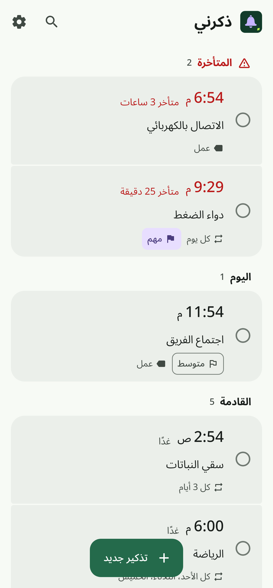
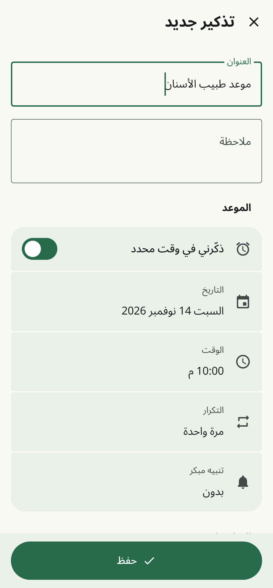
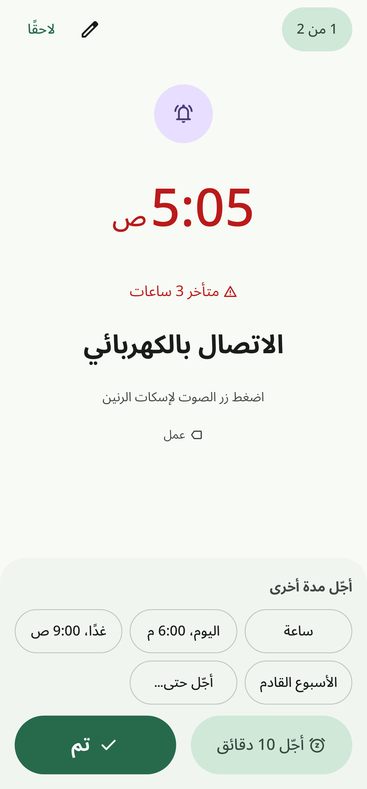
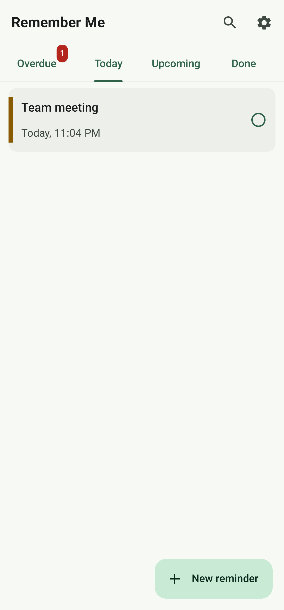

# ذكرني لأندرويد — Remember Me for Android

<p dir="rtl">تذكيرات تبقى حتى تتعامل معها، على أندرويد 8.0 فما فوق. عربي أولًا مع الإنجليزية. مجاني ومفتوح المصدر (Apache-2.0)، بلا حساب ولا إعلانات ولا إحصاءات. ليس على Google Play.</p>

Reminders that stay until you deal with them, on Android 8.0 and later. Arabic first, with English. Free and
open source (Apache-2.0), with no account, ads or analytics. Not on Google Play.

|  |  |  |  |
|---|---|---|---|

<sub>لقطات مولّدة في الاختبارات ببيانات تجريبية — Screenshots generated by the test suite with sample data.</sub>

---

<div dir="rtl">

## بالعربية

### ما هو
- **تنبيهات لا تضيع:** إشعار ثابت فيه «تم» و«أجّل 10 دقائق» و«أجّل حتى…» و«تراجع»، وشاشة تذكير كاملة، و«تذكير عادي» أو «منبّه مهم» (بصوت المنبّه، ويرن في الوضع الصامت، ولا يتجاوز «عدم الإزعاج» إلا إن سمحت إعداداتك بالمنبّهات)، ونغمة لكل تذكير، وحتى 3 تنبيهات مبكرة.
- **إضافة سريعة:** اكتب «اجتماع غداً الساعة 5» فيفهم التاريخ والوقت، مع معاينة قبل الحفظ. قوالب، وإدخال صوتي، ومشاركة من تطبيقات أخرى، وزر في الإعدادات السريعة، وأداة على الشاشة الرئيسية، ومواعيد نسبةً إلى أوقات الصلاة، وتواريخ هجرية.
- **التنظيم:** قائمة واحدة (متأخر، اليوم، القادم، تم) مع السحب والتحديد المتعدد والبحث والقوائم والوسوم، وعرض الأجندة واليوم والأسبوع والشهر، وخطوات لكل تذكير.
- **الثقة:** «صحة التذكيرات» تفحص كل ما قد يؤخر التنبيه على هاتفك وتقترح إصلاحًا واحدًا لكل مشكلة، مع «اختبر التنبيه الآن».
- **بياناتك:** ملف `data.json` نفسه الذي يستعمله ذكرني لويندوز (النقل بين الهاتف والحاسوب في الاتجاهين)، ونسخ احتياطي مشفّر، ونسخة أسبوعية تلقائية، واستيراد التقويم وتصديره.

### المتطلبات والأذونات
أندرويد 8.0 فما فوق (API 26+). الأذونات وسبب كل منها في [docs/PRIVACY.md](docs/PRIVACY.md):
الإشعارات (POST_NOTIFICATIONS)، والمنبّهات الدقيقة (USE_EXACT_ALARM، وSCHEDULE_EXACT_ALARM على أندرويد 12 فقط)، والشاشة الكاملة (USE_FULL_SCREEN_INTENT)، وإعادة الضبط بعد التشغيل (RECEIVE_BOOT_COMPLETED)، والاهتزاز (VIBRATE)، وطلب استثناء البطارية (REQUEST_IGNORE_BATTERY_OPTIMIZATIONS)، وخدمة قصيرة لتشغيل النغمة (FOREGROUND_SERVICE).
ومنذ 1.0.5، للتحديث فقط: الإنترنت (INTERNET) وحالة الشبكة (ACCESS_NETWORK_STATE) وتثبيت الحزم (REQUEST_INSTALL_PACKAGES).

### الخصوصية
- تبقى تذكيراتك على هاتفك. لا حساب، ولا إعلانات، ولا تتبّع، ولا إحصاءات.
- **منذ 1.0.5 يتصل ذكرني بالإنترنت فقط للتحقق من التحديثات وتنزيلها من GitHub.** لا يُرسل أي تذكير أو بيانات عنك. يرى GitHub عنوان IP الخاص بك كأي موقع. يتحقق CI في كل بناء من قائمة الأذونات، ومن أن كود الشبكة موجود في مجلد التحديث وحده.
- الإدخال الصوتي يستعمل خدمة التعرّف على الكلام في هاتفك، وقد ترسل تلك الخدمة صوتك إلى شركتها إن لم تعمل دون إنترنت (التفاصيل في [docs/PRIVACY.md](docs/PRIVACY.md)).

### التثبيت (ليس على Google Play)
التطبيق غير منشور على Google Play. نزّل ملف `RememberMe-X.Y.Z.apk` من [صفحة الإصدارات](https://github.com/sarmadiq9090-coder/remember-me-android/releases/latest) على هاتفك، ثم:
1. افتح الملف من إشعار التنزيل أو من تطبيق الملفات.
2. سيطلب أندرويد السماح بتثبيت التطبيقات من هذا المصدر: اضغط «الإعدادات»، وفعّل «السماح من هذا المصدر» للتطبيق الذي فتحت منه الملف، ثم ارجع.
3. اضغط «تثبيت» ثم «فتح». إن نبّهك Play Protect فاختر «مزيد من التفاصيل» ثم «التثبيت على أي حال» (ينبّه لأن التطبيق ليس من المتجر).
4. عند أول فتح، اسمح بالإشعارات، وافتح «صحة التذكيرات» لترى ما يحتاجه هاتفك.

### التحديثات
- **من داخل التطبيق (منذ 1.0.5):** يتحقق من إصداراته على GitHub. لا يُثبَّت تحديث إلا إذا كان أحدث، وطابقت بصمته (SHA-256) ملف `SHA256SUMS.txt` في الإصدار نفسه، ووُقّع بمفتاح التطبيق نفسه، ثم بموافقتك في شاشة أندرويد.
- **يدويًا:** نزّل أحدث APK من صفحة الإصدارات وثبّته فوق القديم؛ تبقى تذكيراتك.
- **يرفض أندرويد أي تحديث غير موقّع بشهادة التطبيق** (بصمتها أدناه).

### التحقق من الملف
قارن بصمة SHA-256 للملف بما في `SHA256SUMS.txt` في صفحة الإصدار:
- ويندوز: `Get-FileHash RememberMe-X.Y.Z.apk -Algorithm SHA256`
- لينكس/ماك: `sha256sum RememberMe-X.Y.Z.apk`

وللتحقق من التوقيع: `apksigner verify --print-certs RememberMe-X.Y.Z.apk`، ويجب أن تكون بصمة الشهادة:
`8d3b91dcacced148d11a51fb1333a509581ed2ce04ff362f2882c7cda6ae6e26`

### ذكرني لويندوز
لويندوز تطبيق آخر اسمه ذكرني، **منفصل ومغلق المصدر**، على [Microsoft Store](https://apps.microsoft.com/detail/9NGB1F7T7JGN). هذا المستودع لتطبيق أندرويد وحده. يتبادل التطبيقان البيانات عبر ملف النسخ الاحتياطي.

### الترخيص
الشيفرة مرخّصة بـ [Apache-2.0](LICENSE). المكوّنات الخارجية وتراخيصها في [THIRD_PARTY.md](THIRD_PARTY.md) و[NOTICE](NOTICE).
**الاسم «ذكرني / Remember Me» و«FastKiwi» والأيقونة ليست مرخّصة للاستخدام** (المادة 6 من رخصة Apache-2.0): إن نشرت نسخة معدّلة فاستعمل اسمًا وأيقونة مختلفين.

### المساهمة والأمان
المشكلات والاقتراحات مرحّب بها عبر Issues. طلبات الدمج غير مقبولة حاليًا ([CONTRIBUTING.md](CONTRIBUTING.md)).
الثغرات الأمنية: [SECURITY.md](SECURITY.md).

</div>

---

## English

### What it does
- **Alerts that are not lost:** a pinned notification with Done, Snooze 10 minutes, Snooze until… and Undo; a
  full-screen reminder screen; "normal reminder" or "important alarm" (alarm volume, rings in silent mode, never
  through Do Not Disturb unless your DND settings allow alarms); a tone per reminder; up to 3 early alerts.
- **Quick Add:** type "meeting tomorrow at 5" and the date and time are understood, with a preview before saving.
  Templates, voice input, share from other apps, a Quick Settings tile, a home-screen widget, times relative to
  prayer times, and Hijri dates.
- **Organising:** one list (Overdue, Today, Upcoming, Done) with swipe, bulk selection, search, lists and tags;
  agenda, day, week and month views; steps per reminder.
- **Trust:** "Reminder health" checks everything on your phone that could delay an alert and offers one fix per
  problem, with "Test the alert now".
- **Your data:** the same `data.json` as Remember Me for Windows (moves between phone and PC in both directions),
  encrypted backups, a weekly automatic copy, calendar import and export.

### Requirements and permissions
Android 8.0 or later (API 26+). Every permission and why: [docs/PRIVACY.md](docs/PRIVACY.md).
POST_NOTIFICATIONS, USE_EXACT_ALARM (SCHEDULE_EXACT_ALARM on Android 12 only), USE_FULL_SCREEN_INTENT,
RECEIVE_BOOT_COMPLETED, VIBRATE, REQUEST_IGNORE_BATTERY_OPTIMIZATIONS and FOREGROUND_SERVICE (a short service that
plays the tone). Since 1.0.5, for the update check only: INTERNET, ACCESS_NETWORK_STATE and REQUEST_INSTALL_PACKAGES.

### Privacy
- Your reminders stay on your phone. No account, ads, tracking or analytics.
- **Since 1.0.5, Remember Me connects to the internet only to check for and download updates from GitHub.** It
  sends no reminder and no data about you. GitHub sees your IP address, as with any website. CI checks the
  permission list on every build, and that network code exists only in the update folder.
- Voice input uses your phone's speech recognition service, which may send your voice to its company when it
  cannot work offline (details in [docs/PRIVACY.md](docs/PRIVACY.md)).

### Install (not on Google Play)
Remember Me for Android is not published on Google Play. Download `RememberMe-X.Y.Z.apk` from the
[releases page](https://github.com/sarmadiq9090-coder/remember-me-android/releases/latest) on your phone, then:
1. Open the file from the download notification or your Files app.
2. Android asks you to allow installs from this source: tap Settings, turn on "Allow from this source" for the
   app you opened the file with, and go back.
3. Tap Install, then Open. If Play Protect warns you, tap "More details" then "Install anyway" (it warns because
   the app is not from the store).
4. On first launch, allow notifications and open "Reminder health" to see what your phone needs.

### Updates
- **In the app (since 1.0.5):** it checks its GitHub releases. An update is installed only if it is newer, its
  SHA-256 matches `SHA256SUMS.txt` of the same release and it is signed with this app's own key, and then only when
  you confirm on Android's screen.
- **By hand:** download the latest APK from the releases page and install it over the old one; your reminders stay.
- **Android refuses any update that is not signed with the app's certificate** (fingerprint below).

### Verify the download
Compare the APK's SHA-256 with `SHA256SUMS.txt` on the release page:
- Windows: `Get-FileHash RememberMe-X.Y.Z.apk -Algorithm SHA256`
- Linux/macOS: `sha256sum RememberMe-X.Y.Z.apk`

Check the signature with `apksigner verify --print-certs RememberMe-X.Y.Z.apk`; the certificate SHA-256 must be:
`8d3b91dcacced148d11a51fb1333a509581ed2ce04ff362f2882c7cda6ae6e26`

### Provenance (honest note)
Release APKs are built and **signed on the maintainer's PC**, not in CI, so there is no GitHub build attestation.
Each release ships a CycloneDX SBOM (`RememberMe-X.Y.Z.cdx.json`). CI independently builds an unsigned APK from the
same commit and runs every test.

### Remember Me for Windows
The Windows app, also called Remember Me, is a **separate, proprietary app** on the
[Microsoft Store](https://apps.microsoft.com/detail/9NGB1F7T7JGN). This repository is the Android app only. The two
apps exchange data through the backup file.

### Build from source
Requirements: JDK 21 (Temurin), Android SDK platform 36 and build-tools 36.0.0.

```sh
git clone https://github.com/sarmadiq9090-coder/remember-me-android.git
cd remember-me-android
./gradlew :app:testDebugUnitTest     # JUnit, Robolectric and Compose UI tests (also writes screenshots/)
./gradlew :app:lintRelease           # must report "No issues found."
./gradlew :app:assembleRelease       # unsigned APK unless keystore/keystore.properties exists
./gradlew :app:releaseSbom           # dist/RememberMe-<version>.cdx.json (CycloneDX)
```

Dependencies are checked against `gradle/verification-metadata.xml` (SHA-256), and the Gradle wrapper
distribution against its pinned SHA-256. On the maintainer's PC, `./build.sh <tasks>` does the same with the
toolchain described in `env.sh`. Release signing reads `keystore/keystore.properties` (git-ignored, never committed).

More: [RESEARCH.md](RESEARCH.md), [DECISIONS.md](DECISIONS.md), [DESIGN-SPEC.md](DESIGN-SPEC.md),
[STANDARDS.md](STANDARDS.md), [CHANGELOG.md](CHANGELOG.md), [docs/ROADMAP.md](docs/ROADMAP.md),
[docs/FEATURES.md](docs/FEATURES.md), [docs/DATA-FORMAT.md](docs/DATA-FORMAT.md),
[docs/COMPATIBILITY.md](docs/COMPATIBILITY.md), user guides [docs/GUIDE-ar.md](docs/GUIDE-ar.md) /
[docs/GUIDE-en.md](docs/GUIDE-en.md).

### Project layout

```
app/src/main/java/com/fastkiwi/rememberme/
  core/      Repeat.kt (ported from Windows), Tasks.kt, Planner.kt (what to announce, two alarm slots),
             Model.kt (data.json), AlertExt.kt (the `android` object), AlertPolicy.kt (style, DND, sound),
             Organize.kt (tags, steps), Search.kt, Bulk.kt, Calendar.kt, Hijri.kt (ICU Umm al-Qura),
             Templates.kt, quickadd/ (the Windows parser + Android additions), prayer/ (times, cities)
  data/      Store.kt (durable file), Backup.kt, BackupCrypto.kt, Ics*.kt (calendar), Tones.kt, AlertLog.kt,
             ScheduleLog.kt, History.kt, AutoBackup.kt, DeleteAll.kt, Prefs*.kt (phone-only settings)
  alarm/     Engine.kt, Notifier.kt (channels, notifications), RingService.kt (the tone), Receivers.kt,
             DirectBoot.kt (before the unlock), Summary.kt (morning), TestAlarm.kt
  ui/        Home.kt, Alert.kt, Edit.kt, Settings.kt, HealthScreens.kt; home/, editor/, calendar/, health/,
             settings/, quick/; Theme.kt, Ms.kt (icons), L10n.kt, ScreenStack.kt, Haptics.kt
  widget/, tile/, MainActivity.kt, AlertActivity.kt, ShareActivity.kt, Repo.kt, RememberMeApp.kt
app/src/test/   JUnit, Robolectric and Compose UI tests; torture/ (the torture suite and the black-box driver)
tools/          strings_gen.py + strings/*.py (Arabic and English), windows-*.cjs and interchange.sh (checks
                with the Windows app's own code, read from a local checkout), vendor_symbols.py, make_tones.py
torture/        run.sh, reports/, blackbox/ (driver README and examples)
screenshots/    taken by AppUiTest; screenshots/qc/ by QcScreenshotsTest (sample data only)
design/         design council mockups (v1 and v2/shots)
```

### Tested and not tested
The JVM suite runs at Robolectric API 26, 29, 31, 33, 34 and 36 ("Robolectric API N", not "Android N"), with
lint, in CI and before each release; 1.0.0 also passed an independent bug hunt, the torture suite
([torture/README.md](torture/README.md)), a code-blind user test ([docs/BLACKBOX-REPORT.md](docs/BLACKBOX-REPORT.md))
and QC ([docs/QC-1.0.0.md](docs/QC-1.0.0.md)).

**Not tested without a real phone**: real sound and vibration; alarms after hours of deep Doze; OEM battery killers
(Xiaomi, Samsung, Huawei, OPPO, vivo); the full-screen screen over a real lock screen; a locked restart; the widget
on a launcher; the Quick Settings tile; Android 14's non-linear font scaling; TalkBack itself. Phones actually tried
are listed in [docs/COMPATIBILITY.md](docs/COMPATIBILITY.md).

### Licence
Code: [Apache-2.0](LICENSE). Third-party components and licences: [THIRD_PARTY.md](THIRD_PARTY.md) and
[NOTICE](NOTICE). The names "Remember Me", «ذكرني» and "FastKiwi" and the icon are trademarks and are not licensed
(Apache-2.0 section 6): a modified version must use a different name and icon.

### Contributing and security
Issues and suggestions are welcome. Pull requests are not accepted for now ([CONTRIBUTING.md](CONTRIBUTING.md)).
Security problems: [SECURITY.md](SECURITY.md).
